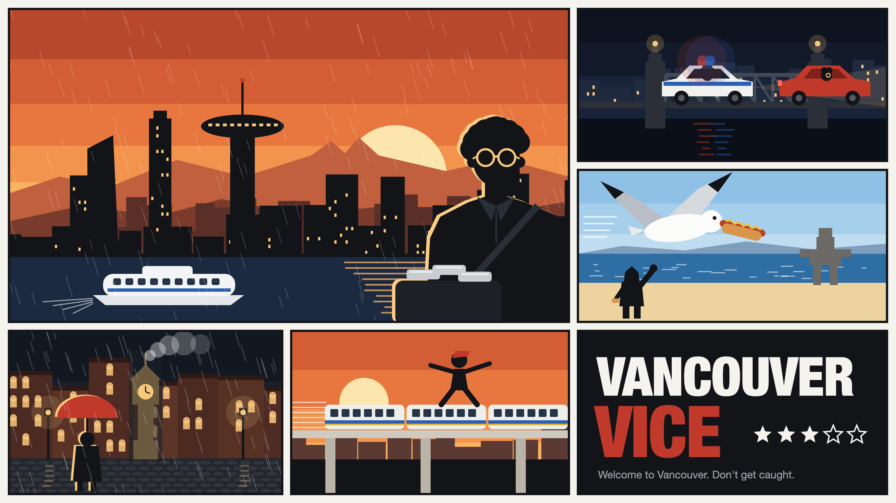
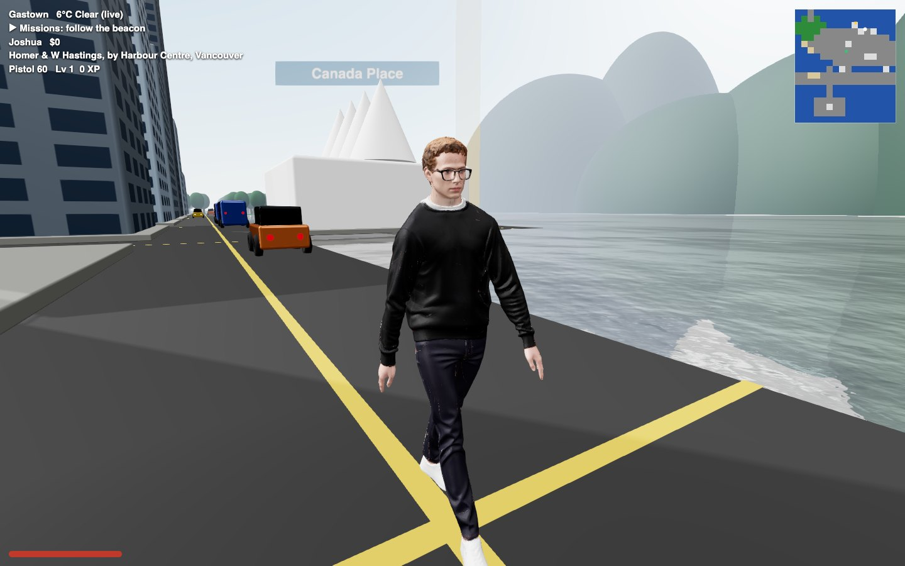

<h1 align="center">Vancouver Vice</h1>

<b>Welcome to Vancouver. Don't get caught.</b>

Rent is four grand and it rains nine months a year. Steal a car on Granville, rob the 7-Eleven, lose the cops on the Burrard Bridge. The more trouble you cause, the more stars you get.

It's the real city: 3,359 real downtown buildings and 8,378 named streets from OpenStreetMap, plus Kits, Victoria and 20-odd more Lower Mainland areas. Play as Joshua in Gastown, Ben in Kits or Alexandre in Victoria, and switch any time.

## Cast
Your family gets pulled in. Brian, your dad, has the garage, the boat, and a thing he wants back: his hard drive. Christine calls at terrible moments. Sarah is smarter than all three of you and refuses to help. Then she's the best one on the job.

## The game
Five story missions, then endless side jobs. Fists, pistol, shotgun and SMG. Cars that smoke, burn and blow up, and five-star cops who shoot back. Pawn the Apple Store loot at Granville Pawn, rob the 7-Eleven, walk into Dad's garage in Kits. Live Vancouver weather, radio, XP and a save that picks up where you left off. Joshua looks like Joshua: ginger, tortoiseshell glasses, black crewneck.

## Native build (new)
The real game is moving to a native app built with Godot, an engine light enough for an 8 GB iMac. It loads the real downtown map from the same data as the web build: 17,659 buildings and 19,483 streets. It opens on a fly-over, then a title screen with Continue, New game, Settings and Quit. You play as Joshua outside the Apple Store on Georgia. Tab switches to Dad in Kits, and Esc pauses and saves.

Run it with `~/Applications/Godot.app/Contents/MacOS/Godot --path godot`, or build `Vancouver Vice.app` with `sh tools/godot_app.sh`. To test it with no window, run `Godot --headless --path godot -- --qa /tmp/qa`. It checks the opening, title, walking, street names, switching characters, pause, save and continue.

| Benchmark (iMac 2017, i5, 8 GB, Radeon Pro 570) | |
|---|---|
| City build | 1.8 s |
| Frame (process) | 4.9 ms, 60 fps capped |
| Memory | 155 MB |
| City geometry | 546 meshes, 629k triangles |

The Unreal build on Google's photoreal 3D Vancouver will be rebuilt from `tools/` and `unreal/` on the Mac Mini.

## Play
Free. Download it for Mac, Windows, Linux or Android from [releases](https://github.com/nulljosh/vancouvervice/releases/latest). There's no browser version: the game runs in the app.

## Controls
W A S D to move, Shift to run, Space to jump. Mouse to look, click to shoot, F to punch. E to jack a car, R for the radio. T to fast travel. Tab to switch characters. Esc for the menu.

On Android: stick on the left, drag to look, buttons on the right.

---
Apache 2.0 · Map data © OpenStreetMap contributors · People by Microsoft Rocketbox (MIT) · Car by vicent091036 (CC-BY 4.0) · [Privacy](https://vancouvervice.jaybulb.com/privacy.html) · [Changelog](CHANGELOG.md) · [Roadmap](roadmap.md) · [How it works](docs/ARCHITECTURE.md)
